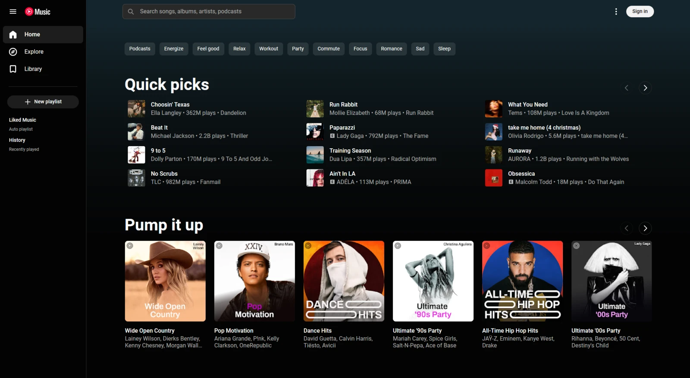

# YouTube Music GPUI

A native YouTube Music client for Linux, built with Rust and GPUI. Audio and video play through libmpv and yt-dlp. It runs on Wayland and X11 with YouTube Music's dark interface.



- Browse Home, Explore, charts, artists, albums and playlists, with search suggestions and category filters.
- Play audio and video with a persistent, drag-to-reorder queue, shuffle, repeat, radio and autoplay. Click the player bar to open the player page with Up next, lyrics, read-only comments and related music.
- Read lyrics and credits, and browse podcasts with episode descriptions and chapters.
- Connect your account to access your library, edit playlists and record playback history.
- Control playback with keyboard shortcuts, media keys and MPRIS desktop controls.

This is an independent client using YouTube Music's unofficial API. Account support is experimental, and service changes can break playback or account features.

## Build and install

Requires Rust, a C compiler, pkg-config and Linux 5.3 or newer for extractor exit notifications. On Arch:

```sh
sudo pacman -S --needed git rust base-devel mpv yt-dlp libglvnd wayland libx11 libxext libxcb libxkbcommon libxkbcommon-x11 fontconfig freetype2 vulkan-driver
git clone https://github.com/AksharP5/yt-music-gpui
cd yt-music-gpui
bin/build
bin/install
```

Launch YouTube Music from your app launcher, or run `target/release/yt-music-gpui` directly. The installer uses `~/.local/bin` and `~/.local/share`, respecting `XDG_DATA_HOME`, and copies the license files alongside. It does not install dependencies.

Builds default to two jobs. Set `CARGO_BUILD_JOBS` to change that.

On Arch, `packaging/PKGBUILD` builds the `yt-music-gpui-git` package from the latest commit on GitHub. Copy it anywhere and run `makepkg -si`.

## Connect your account

Connection requires Python 3, xdg-utils, libsecret's `secret-tool` and a running Secret Service keyring.

1. Choose **Sign in**, or launch with `--connect`.
2. Sign in to YouTube Music in your default browser. Zen, Firefox, Chromium, Google Chrome and Brave are supported, including Omarchy's default-browser launcher.
3. Return to Music. Your account is verified and saved automatically.

The app reads YouTube cookies from your default browser profile and saves the confirmed session in your desktop keyring. For Chromium, Chrome and Brave that is the profile you used last, and the cookies are decrypted with the browser's own Safe Storage key from the same keyring. The app uses your browser session rather than OAuth, so it has that session's YouTube access. It creates no persistent plaintext cookie export. Private windows, containers and partitioned sessions are unsupported.

Signed-in playback runs through an extractor reviewed against one yt-dlp release, pinned in `src/ytdlp_account.py` (currently **2026.08.19**). With any other yt-dlp version, songs play as a guest instead. A weekly CI job tests each new yt-dlp release so the pin can be bumped promptly.

Once connected, the browser can stay closed. The app restores your saved account and can renew rejected sessions from its confirmed profile. Google can still revoke a sign-in. Older saved connections need one reconnect to enable renewal.

Your profile menu shows the connected name and handle. Use **Switch account** to connect another account. Closing the sign-in dialog cancels an unfinished connection.

Use `--guest` to start without restoring the saved account. Guest likes and saved collections stay local and are not uploaded when you connect.

### Staying in sync

- Songs you play show up in your YouTube Music history, and listening time is reported the way the web player reports it.
- Podcast episodes and long videos resume where you left off, including progress saved by YouTube Music.
- Likes and dislikes apply immediately and revert if YouTube Music rejects them. Playlist edits wait for confirmation.
- Recently visited pages appear immediately from a session cache of up to 12 inactive pages. Responses stay fresh for three minutes, then refresh in place. Forward visits start at the top and replace expired continuation pages; Back restores your scroll position and loaded rows. After a confirmed or rejected edit, the next visit fetches a new page. History also refreshes after successful playback reports.
- When you return to the window after three minutes or more, the current page picks up changes made elsewhere in YouTube Music's order, without losing your scroll position. Ctrl R reloads the page right away.

## Controls

| Key | Action |
| --- | --- |
| / or Ctrl K | Search |
| Ctrl R | Reload the current page |
| Alt Left | Go back |
| Space | Play or pause |
| Ctrl Right / Ctrl Left | Next / previous song |
| Right / Left | Seek 5 seconds |
| Up / Down | Adjust volume |
| L | Like the current song |
| Q | Open or close the player page |
| F | Toggle video fullscreen |
| Escape | Dismiss a dialog or leave fullscreen, the player page or search |
| ? | Keyboard help |
| Ctrl Q | Quit |

Tab and Shift+Tab move through every control, arrow keys move through open menus, and right-clicking a song, card or collection opens its menu.

Settings includes playback speed, audio quality and video resolution limits. The song menu has mix, queue, playlist, sharing and credits actions when available, in the same order as YouTube Music.

## Development

See [CONTRIBUTING.md](CONTRIBUTING.md) for setup, validation, integration tests and running an isolated instance next to your installed app. To sample CPU and memory for a running release build, use `bin/profile APP_PID 30`.

Playback sockets and the account extractor live in a private directory under `$XDG_RUNTIME_DIR`. Normal shutdown, SIGTERM and SIGINT remove it. Repeating the same signal forces termination if cleanup hangs.

Local preferences, queue and guest library data live in `$XDG_DATA_HOME/yt-music-gpui/library.json`, defaulting to `~/.local/share/yt-music-gpui/library.json`.

MIT licensed. Third-party attributions and licenses are listed in [NOTICE](NOTICE).
