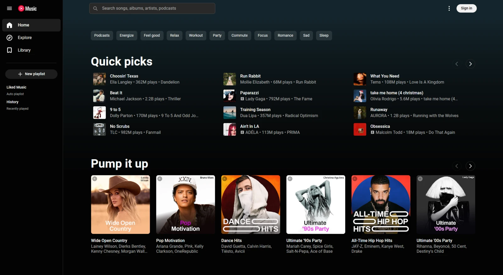

# YouTube Music GPUI

A fast, native YouTube Music client for Linux, built with Rust and GPUI. Audio and video play through libmpv.



- Native views for Home, Explore, charts, artists, albums, playlists, podcasts and search.
- Audio and video playback with a drag-to-reorder queue, shuffle, repeat, radio and autoplay.
- Player page with Up next, lyrics, credits, comments and related music.
- Sign in to use your library, edit playlists and keep your YouTube Music history in sync.
- Suggestions and related playlists for editable playlists when YouTube supplies them. Refresh replaces the recommendations, and Add saves a suggested song to the playlist.
- Volume levelled between songs like the YouTube Music website (needs mpv 0.38 or newer).
- Autoplay and Next skip songs the app knows you disliked.
- Picks up the last song where you left off after a restart.
- Keyboard shortcuts, media keys and MPRIS desktop controls, including reversible album, playlist and artist shuffle.

A warm guest session measured 191 ms median from clicking a song to playback, across eight clicks on songs that were not prepared ahead. Cold starts and fallback lookups can take longer. See the [measurement method and results](https://github.com/AksharP5/yt-music-gpui/pull/34). A separate 30-second playback sample on Arch used about 1% of one CPU core across the app and its resolver; CPU use varies with hardware and workload.

This is an independent client using YouTube Music's unofficial API. YouTube changes can break playback or account features.

## Install

Requires x86_64 Linux with glibc 2.39 or newer and a working Vulkan driver: Ubuntu 24.04+, Debian 13+, Fedora, openSUSE Tumbleweed or Arch.

**Ubuntu, Debian, Fedora, openSUSE:** download the `.deb` or `.rpm` from the [latest release](https://github.com/AksharP5/yt-music-gpui/releases/latest) and install it:

```sh
sudo apt install ./yt-music-gpui_*_amd64.deb                         # Ubuntu, Debian
sudo dnf install ./yt-music-gpui-*.x86_64.rpm                         # Fedora
sudo zypper install --allow-unsigned-rpm ./yt-music-gpui-*.x86_64.rpm # openSUSE
```

To upgrade, install the newer package the same way. Remove it with your package manager.

**Any distribution:**

```sh
curl -fsSL https://github.com/AksharP5/yt-music-gpui/releases/latest/download/install.sh | sh
```

The script installs into your home folder, tells you which system packages are missing and asks before using sudo. Run it again to upgrade.

If you already have the release tarball and its matching `.sha256` file, use `sh install.sh --archive /path/to/release.tar.gz`. Offline upgrades require the pinned yt-dlp and a supported Deno. If you use the installer’s private Deno, its version must match the release pin.

To remove the app:

```sh
curl -fsSL https://github.com/AksharP5/yt-music-gpui/releases/latest/download/install.sh | sh -s -- --uninstall
```

Use either a package or the script, not both. Uninstalling keeps your library, settings and saved account. See [SECURITY.md](SECURITY.md) for what each method checks and trusts.

**Arch, from source:** `packaging/PKGBUILD` builds the latest commit. Copy it anywhere and run `makepkg -si`.

## Sign in

Sign-in needs a supported default browser: Zen, Firefox, Chromium, Google Chrome, Brave or Helium. The app saves your session in a Secret Service keyring such as GNOME Keyring or KWallet. Without one, it asks whether to save the session unencrypted in a file only your user can read, or keep you signed in until you quit.

1. Choose **Sign in**.
2. Sign in to YouTube Music in your browser.
3. Return to the app. Your account is verified and saved automatically.

The app copies your browser's YouTube session, so the browser can stay closed afterwards. It has the same access to YouTube as that browser session. Private windows and browser containers aren't supported. Start with `--guest` to skip the saved account.

## Keyboard shortcuts

| Key | Action |
| --- | --- |
| / or Ctrl K | Search |
| Space or ; | Play or pause |
| J, Shift N or Ctrl → | Next song |
| K, Shift P or Ctrl ← | Previous song |
| → / ← | Seek 5 seconds |
| L / H or Shift → / Shift ← | Seek 10 seconds |
| Shift L / Shift H or Ctrl Shift → / ← | Seek 1 second |
| ↑ / ↓ or = / - | Volume up / down |
| M | Mute |
| R | Repeat: off, all, one |
| S | Shuffle |
| + | Like the current song |
| _ | Dislike the current song |
| Q | Open or close the player page |
| F | Video fullscreen |
| Ctrl R | Reload the page |
| Alt ← or mouse Back | Back |
| Alt → or mouse Forward | Forward |
| Escape | Close a dialog, fullscreen, the player page or search |
| ? | Keyboard shortcuts |
| Ctrl Q | Quit |

Previous restarts the current song once playback has passed three seconds. The desktop media control follows the same rule.

Right-click a song, card or collection for its menu. Use ↑ and ↓ to move between actions or Home and End to jump to the first or last action. The menu scrolls to the focused action.

The player keeps the selected tab when you change tracks. Lyrics, Comments and Related show when their content is unavailable.

When playback is stopped, Next and Previous select songs without starting playback. Desktop controls show the selected song’s duration when available.

While searching, scroll through suggestions or use ↑ and ↓ to reveal and select them. Press Enter to open the selected suggestion.

In **Save to playlist**, use Tab and Shift+Tab to move through the destinations. The list scrolls to the focused playlist. Press Enter to choose it.

While dragging a song in **Up next**, press Escape to cancel the move. Press Escape again to close the player page. Leaving Up next, shuffling, or replacing the queue also cancels the move.

In an editable playlist, Tab reveals each Suggestions control as it receives focus. Press Enter on **Refresh** for a new batch or on **Add to playlist** to save a song. Suggested songs stay out of the playlist's count and Play all until YouTube confirms an add. If the song is already saved, use Tab to reach **Add anyway** or Escape to return to the song.

## Contributing

See [CONTRIBUTING.md](CONTRIBUTING.md) for building from source, tests and running a development build next to your installed app. Report security issues privately as described in [SECURITY.md](SECURITY.md).

## License

MIT. Third-party attributions are in [NOTICE](NOTICE).
